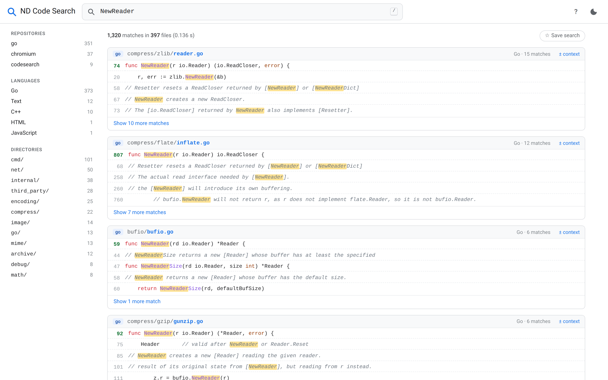
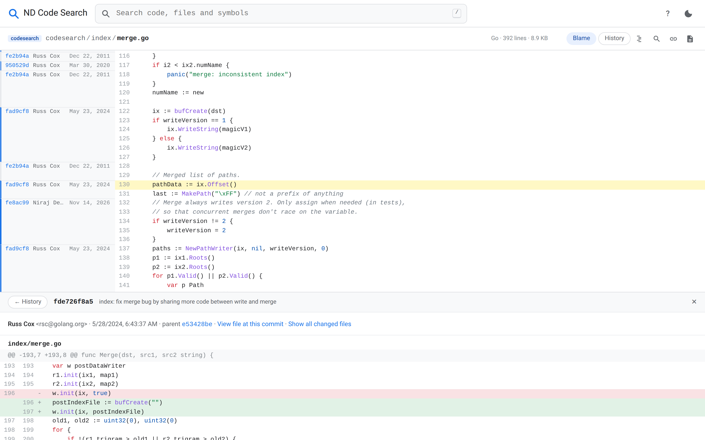
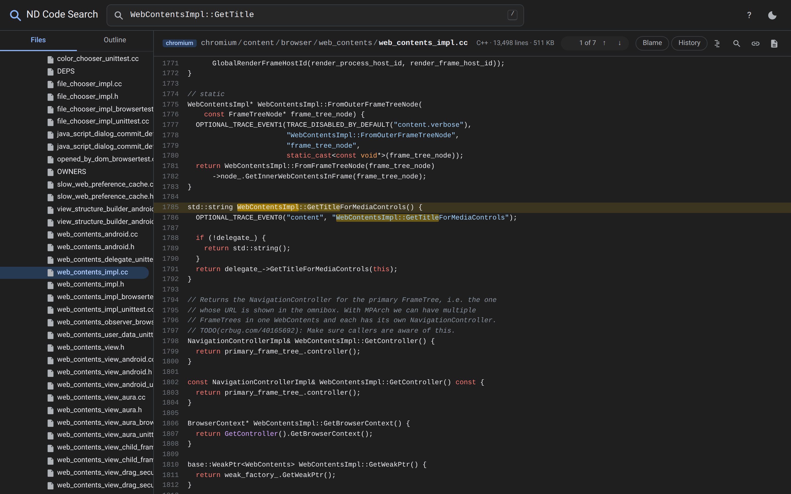
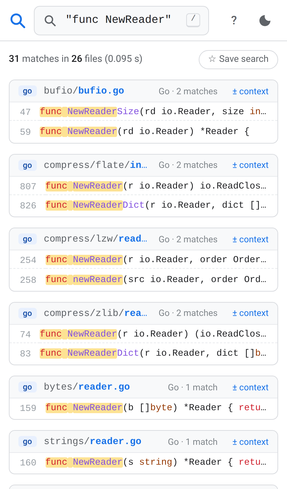

# ND Code Search

**Fast, self-hosted code search for the repositories on your own machine**, in the
spirit of Google's [Code Search](https://opensource.googleblog.com/2020/04/code-search-for-google-open-source.html)
and [cs.android.com](https://cs.android.com). Point it at a list of folders, and get
regex search, syntax highlighting, click-through definitions and references, git
blame and history, all in a clean web UI that handles trees as large as Chromium
or AOSP.



ND Code Search builds on Russ Cox's trigram-index [codesearch](https://github.com/google/codesearch)
tools and adds a configurable incremental indexer and a full web app.

## Features

**Search**
- Regular expression search over every indexed repository, narrowed by a
  trigram index so that queries over a million files take a fraction of a second.
- Google Code Search–style queries: `file:`, `lang:`, `repo:`, `sym:`, `case:`,
  `-term`, `OR`, `NOT`, and `( )` grouping; path globs like `file:src/**/*.kt`;
  `usage:`, `comment:` and `string:` to match only in code, comments or strings;
  `is:test`, `is:generated` and `is:vendored` to include or exclude those files.
- Search is case-insensitive by default (`case:yes` for exact case).
- File and folder name matches, plus suggestions as you type.
- Search within the folder you are browsing.
- Results ranked with definitions first (using a symbol index built while
  indexing) and recently changed files slightly ahead, and a sidebar to narrow by repository, language and directory, or
  hide tests, generated and third-party code.
- Expand any result in place to see the lines around each match.
- Saved searches (shared across your devices) and per-browser history of
  searches and recently viewed files.
- Code monitors: mark a saved search as monitored to be alerted (on the home
  page, and optionally through a webhook) when new code matches it.

**Code browsing**
- Syntax highlighting for about 300 languages (via [Chroma](https://github.com/alecthomas/chroma)),
  including Android files such as `Android.bp`, AIDL, HIDL and `.rc`.
- Click any identifier to see its definitions and references; Ctrl/⌘-click jumps
  straight to the definition. Hover over it for a card with its signature and
  doc comment.
- Call hierarchy: the functions that call a function, and the functions it
  calls, as an expandable tree.
- File tree, file outline (classes, functions, methods), and find in file.
- Links to lines and line ranges; copy the path, a link, a permalink pinned to
  the current git commit, or the raw file URL.
- In-place preview of HTML files, with their CSS, images and scripts, sandboxed
  away from the app.

**Git**
- Blame: who last changed each line, and when.
- File history that follows renames, with diffs (for the file or the whole
  commit), and any version of a file one click away.
- Search commit messages and diffs (`type:commit`, `type:diff`) across all
  repositories, with author and date filters.
- Browse any branch, tag or commit: the file tree, folders and files follow the
  selected revision while you navigate (search always covers the working tree).
- Works with nested repositories such as AOSP's `repo` checkouts.

**Indexing**
- A YAML config file lists the folders to index and where the index lives.
- Incremental: after the first run, only files whose size or modification time
  changed are re-read, and only the affected index shards are rewritten.
- Honors `.gitignore` files (including nested ones) plus your own exclude patterns;
  binaries and build output are skipped by default.
- The web server keeps the index fresh in the background.

**For tools and AI agents**
- A documented JSON API (`/api/v1/...`) and an MCP server (`csmcp`) that let
  scripts and AI coding agents search and read your indexed code. See
  [docs/api.md](docs/api.md).

**Everywhere**
- Light and dark themes, keyboard shortcuts, and a layout that works on phones,
  including over a private network such as Tailscale.

## Screenshots

| | |
|---|---|
|  |  |
| **Home:** your repositories at a glance | **Click-through navigation:** definitions, references and the file outline |
|  |  |
| **Git:** blame, history and commit diffs | **Dark mode:** a 13,000-line Chromium file opened from a search |

<p align="center"></p>

## Performance

Measured on an AMD Ryzen 9 7950X (16 cores, 32 threads) on Linux, with the
source files already in the OS page cache. Your numbers will vary with disk
speed, CPU and cache state.

| Task | Size | Time |
|---|---|---|
| Full index of a Chromium checkout | 802,000 files, 5.8 GB of text | ~21 s |
| Re-scan with nothing changed | 115,000 files | 0.2 s |
| Incremental update after editing 5 files | 115,000 files | 0.6 s |
| Typical searches | 800,000+ files | 50–400 ms |

The index takes roughly 10% of the size of the indexed source.

## Quick start

Requires [Go](https://go.dev/dl/) 1.23 or newer, and `git` for blame and history.

```sh
go install github.com/ndesai/codesearch/cmd/...@latest
```

or, from a clone:

```sh
git clone https://github.com/ndesai/codesearch
cd codesearch
go install ./cmd/...
```

Create a configuration file listing the folders to search. On Linux it lives
at `~/.config/codesearch/config.yaml`:

```sh
mkdir -p ~/.config/codesearch
curl -o ~/.config/codesearch/config.yaml https://raw.githubusercontent.com/ndesai/codesearch/master/codesearch.example.yaml
$EDITOR ~/.config/codesearch/config.yaml
```

On macOS the default location is `~/Library/Application Support/codesearch/config.yaml`,
and on Windows `%AppData%\codesearch\config.yaml`. Anywhere else works too: set
`$CODESEARCH_CONFIG` or pass `-config file` to the commands.

```yaml
index_dir: ~/.cache/codesearch     # where the index is stored
listen: localhost:2473
update_interval: 10m               # background re-indexing; 0 to disable

repos:
  - path: ~/src/myproject
  - name: aosp
    path: ~/aosp
    exclude: [/out, /prebuilts]    # "/name" = only at the repository root
```

Then start the web app and open <http://localhost:2473/>:

```sh
csweb
```

`csweb` builds the index in the background on first start and keeps it up to
date. You can also index from the command line (for example from cron):

```sh
csindex            # build or incrementally update the index
csindex -status    # what is indexed, and how big
csindex -full      # rebuild from scratch
```

`csweb` and `csindex` can run at the same time: they take turns using a lock
in the index directory, and `csweb` picks up index changes within a few seconds.

## Configuration

The configuration is a YAML file; [`codesearch.example.yaml`](codesearch.example.yaml)
is a commented template. Paths may use `~` and `$ENV_VARS`, and relative paths
are relative to the configuration file.

| Option | Default | Meaning |
|---|---|---|
| `repos` | (required) | The folders to index. Each has a `path`, an optional `name` (default: the folder name, used in `repo:` queries), optional `exclude` patterns, and an optional `scip` index for precise cross references (see below). |
| `index_dir` | `~/.cache/codesearch` (macOS: `~/Library/Caches/codesearch`, Windows: `%LocalAppData%\codesearch`) | Where the index, saved searches and lock file are stored. Can also be set with `$CODESEARCH_INDEX_DIR` or `-index_dir` (see below). |
| `listen` | `localhost:2473` | Address for `csweb`. See [Security](#security) before changing it. |
| `update_interval` | `0` (off) | How often `csweb` re-indexes in the background, e.g. `10m`. |
| `exclude` | | Patterns skipped in every repository (see below). |
| `use_default_excludes` | `true` | Skip binaries, images, archives, `node_modules`, minified files and similar. |
| `api_token` | | If set, the `/api/v1` JSON API and `csmcp -http` require `Authorization: Bearer <token>`. |
| `monitor_webhook` | | URL that receives a JSON `POST` (`search`, `query`, `text`, `matches`) when a monitored search has new matches; works with Slack incoming webhooks, ntfy and the like. |
| `rank_recent` | `true` | Rank recently modified files slightly higher (the boost halves every 30 days). |
| `use_gitignore` | `true` | Skip files ignored by `.gitignore` files (at any depth) and `.git/info/exclude`. |
| `include_hidden` | `false` | Index files and folders whose names start with `.`. |
| `max_file_size` | `2MB` | Larger files are not indexed. |
| `shard_files` | `25000` | Files per index shard. Smaller shards make incremental updates cheaper. |
| `parallelism` | half the CPUs, at most 4 | Shards indexed at once. Each indexing worker uses about 400 MB of memory. |

Exclude patterns use shell glob syntax. A pattern without a slash matches a
file or folder name anywhere (`node_modules`, `*.min.js`); a pattern with a
slash matches from the repository root (`/out` skips only the top-level `out`
folder). Changing excludes, `max_file_size`, `include_hidden` or
`use_gitignore` makes the next update rebuild that repository's index.

### Precise cross references (SCIP)

Cross references are search based by default. For compiler-accurate results,
generate a [SCIP](https://github.com/sourcegraph/scip) index with your
language's indexer (for example `scip-go`, `scip-java`, `scip-typescript`,
`scip-python` or `scip-clang`) and point the repository at it:

```yaml
repos:
  - path: ~/src/myproject
    scip: ~/src/myproject/index.scip   # or a directory of .scip files
```

Clicking an identifier the index covers then lists exactly its definitions and
references, marked **Precise** in the panel. Files changed since the index was
written are not trusted: they are left out of precise results, and clicks in
them use search-based cross references. `csweb` reloads the index when the file
changes. Hover cards, the call hierarchy and the API still use search-based
results.

### Choosing where the index is stored

The index (the cache directory) can take several gigabytes for large trees, so
you may want it on a particular disk. Set it in any of these ways; the first
one found wins:

1. The `-index_dir dir` flag of `csweb` or `csindex`.
2. The `CODESEARCH_INDEX_DIR` environment variable.
3. `index_dir:` in the configuration file.
4. The default: `codesearch` in your user cache directory.

A relative path in the flag or environment variable is relative to the current
directory; in the configuration file, it is relative to the file. `~` and
`$VARS` are expanded. If you run `csweb` and `csindex` separately, give them the
same directory. Moving the index to a new directory makes the first update
there a full rebuild. To keep your saved searches, copy `saved-searches.json`
from the old directory to the new one; then the old directory can be deleted.

```sh
csweb -index_dir /mnt/fast-ssd/codesearch
CODESEARCH_INDEX_DIR=/mnt/fast-ssd/codesearch csindex
```

## Search syntax

| Query | Meaning |
|---|---|
| `foo bar` | Files containing both `foo` and `bar`. Each term is a regular expression. |
| `foo OR bar` | Files containing either (`AND` is implied between terms and may be written out). |
| `-foo`, `NOT foo` | Exclude files containing `foo`. |
| `(a OR b) -file:test` | Grouping. `file:` and `lang:` work inside groups too. |
| `"foo(bar"` | Literal text. Invalid regular expressions are also searched literally. |
| `file:\.cc$` | Path matches a regular expression (also `f:`, `path:`, `-file:`). |
| `file:src/**/*.kt` | Path glob: `*` within a folder, `**` across folders, leading `/` anchors at the root. |
| `lang:java` | Language: `c`, `c++`, `java`, `kotlin`, `go`, `py`, `rust`, `ts`, `bp`, `aidl`, … |
| `repo:aosp` | Repository name, as a regular expression (also `r:`, `-repo:`). |
| `content:file` | Search contents only, even for a word that looks like a filter (also `c:`). |
| `.foo` | While browsing a file or folder: search for `foo` in that folder. Adds `repo:` and `file:` filters you can see and edit. The **Search here** button does the same. |
| `sym:Activity` | Definitions of a symbol. |
| `class:.*Impl$` | Type definitions (class, struct, interface, enum, …) whose names match a regular expression. `function:` (or `func:`) lists functions and methods, `symbol:` any kind. Qualified names work too: `function:Reader.Read`, `func:Rect::intersect`. Combine with `file:`, `lang:` and `repo:`, or with each other using `OR`. |
| `is:test` | Test files; also `is:generated` (by path, or a "Code generated … DO NOT EDIT" / `@generated` marker) and `is:vendored` (`third_party/`, `external/`, `vendor/`, `node_modules/`, …). `-is:test` excludes them. |
| `usage:foo` | `foo` outside comments and string literals (also `code:`). |
| `comment:foo`, `string:foo` | `foo` only inside comments, or only inside string literals. |
| `type:commit fix` | Search commit messages in the git history of every repository (including nested ones); `type:diff foo` searches the lines commits added or removed. Narrow with `author:`, `after:2024-01-01`, `before:`, `file:` and `repo:`. |
| `multiline:yes` | Let patterns span lines; `.` also matches newlines (also `pcre:yes`). Example: `multiline:yes func\s\w+\(\)\s*\{\s*return\snil`. Uses Go's regexp engine on candidate files, so it is slower than normal searches. |
| `case:yes` | Case-sensitive. Search is case-insensitive by default; `case:auto` is case-sensitive only for terms with upper-case letters. |

Parentheses group only when the group contains an operator (or a parenthesis
stands alone), so code like `func (b *Reader)` is searched as written.
`repo:`, `case:` and `sym:` apply to the whole query. `class:`, `function:` and
`symbol:` list definitions from the symbol index, so they can't be mixed with
text search terms.

## Keyboard shortcuts

| Key | Action |
|---|---|
| `/` | Focus the search box |
| `j` / `k`, `Enter` | Next / previous search result, open it |
| `f` | Find text in the current file |
| `n` / `N` | Next / previous match in the file |
| `b` | Toggle blame |
| `h` | File history |
| `o` | File outline |
| `y` | Copy a permalink pinned to the current commit |
| `i` | Show the hover card for the selected identifier |
| `t` | Toggle the sidebar |
| `Esc` | Close the bottom panel |
| `?` | Help |

With the mouse: hover over an identifier for its definition and documentation,
click it for its definitions and references,
Ctrl/⌘-click to jump to its definition, click a line number to link to it and
Shift-click another to select a range, and click a commit in the blame column to
see its diff.

## How it works

- **Trigram index.** Each file is indexed by the three-byte sequences (trigrams)
  it contains. A regular expression query is turned into a boolean query over
  trigrams that picks a small set of candidate files, which are then searched
  with a fast DFA regular expression engine. Russ Cox's article
  [Regular Expression Matching with a Trigram Index](https://swtch.com/~rsc/regexp/regexp4.html)
  explains the approach.
- **Sharded, incremental indexing.** Each repository is split into shards
  covering ranges of paths. A manifest records every file's size and
  modification time; an update walks the tree in parallel (metadata only),
  re-reads only changed files, and merges a small delta index into each
  affected shard.
- **Symbol index.** While indexing, each file's definitions (types, functions,
  methods, build modules, ...) are extracted with per-language patterns and
  stored per shard in a name-sorted table, which `sym:` queries and cross
  references look up directly.
- **Precise cross references** come from SCIP indexes when configured: the
  clicked position is looked up in the index's occurrences, so overloaded or
  same-named symbols are told apart.
- **Search-based cross references.** Otherwise, clicking an identifier searches the index
  for the whole word; each hit is a definition if the symbol index lists it or
  per-language heuristics recognize it (for fields, constants and the like),
  and a reference otherwise. This works for every language without building
  the code, at the cost of the occasional misclassified line. It is not
  compiler-accurate like Kythe-based cross references.
- **Outline** comes from per-language patterns over the file's text, so it
  needs no build either.
- **Call hierarchy** is search based too: a call is the function's name
  followed by `(` in code (not in comments or strings) in a file of the same
  language family, and its caller is the function whose definition precedes it
  in that file's outline. Callees are the calls in the function's body,
  resolved to their nearest definitions through the symbol index.
- **Git integration** runs `git blame`, `git log` and `git show` on demand,
  with timeouts, in whichever repository contains the file.

See [ARCHITECTURE.md](ARCHITECTURE.md) for a tour of the code.

## Where data is stored

Everything below lives in the index directory (`index_dir`) unless noted.

- `index_dir/repos/<name>/`: each repository's index shards (`.idx`), symbol
  tables (`.sym`) and manifest.
  Repositories removed from the configuration have their index deleted on the
  next update.
- `index_dir/saved-searches.json`: saved searches and their monitor alerts,
  shared by every browser that uses the server.
- Each browser's local storage: recent searches, recently viewed files, and UI
  preferences such as the theme.

## Using it from other devices

To use ND Code Search from your phone or laptop, run `csweb` with `listen` set
to an address those devices can reach, ideally a private network such as
[Tailscale](https://tailscale.com) (for example `listen: 100.x.y.z:2473`, your
machine's Tailscale address). `listen: 0.0.0.0:2473` also works but exposes the
server on every network the machine is connected to. Copying links works over
plain `http://` addresses as well.

## Security

ND Code Search serves your source code and has no login: anyone who can reach
the server can read every indexed file. Keep `listen` on `localhost` (the
default), or bind it only to a private network as described above.

- On a localhost address, the server rejects requests addressed to other host
  names, which blocks DNS-rebinding attacks from web pages you visit. This check
  is off when listening on other addresses.
- Requests that change state (saved searches, re-indexing) require a custom
  header, so other web sites cannot trigger them.
- Raw files are always served as plain text, and HTML previews run in a sandbox
  with an opaque origin, so a malicious page in a repository cannot read the app
  or other files.
- Only files inside the configured folders can be read; `..` paths and
  symbolic links that point outside are refused.

## Limitations

- Without a SCIP index, cross references and the outline are heuristic, not
  compiler-accurate. Expect
  the occasional missed definition, or a declaration such as a C++ forward
  declaration listed as a definition.
- Search results stop after 2,000 matching files (the page says so); refine the
  query with `file:`, `lang:` or `repo:` to see the rest.
- Git blame and history call `git` on demand; on very long histories they can be
  slow, and they give up after 30 seconds.
- Files larger than `max_file_size` are not indexed, and files over 20 MB are
  not displayed.
- HTML previews cannot use cookies, local storage, or JavaScript modules loaded
  from the server.

## Command-line tools

| Command | Purpose |
|---|---|
| `csweb` | The web app (also keeps the index up to date) |
| `csindex` | Build and incrementally update the index from the config file |
| `csmcp` | MCP server for AI agents, over stdio or HTTP ([docs/api.md](docs/api.md)) |
| `cindex`, `csearch`, `cgrep` | The original single-index command-line tools from google/codesearch |

`csweb [-config file] [-index_dir dir] [-listen addr] [-noindex] [-verbose]`
- `-index_dir` stores the index in `dir` (see
  [Choosing where the index is stored](#choosing-where-the-index-is-stored));
  `-listen` overrides the configuration's address; `-noindex` turns off
  background indexing (use it when `csindex` runs separately); `-verbose` logs
  details of each index update.

`csindex [-config file] [-index_dir dir] [-full] [-status] [-v] [-wait=false] [repo...]`
- With repository names, only those repositories are updated. `-index_dir`
  works as for `csweb`. `-full` rebuilds
  from scratch, `-status` prints what is indexed, and `-wait=false` exits instead
  of waiting if another indexer (such as `csweb`) is running.

## Development

```sh
go test ./...        # unit tests, including incremental-indexing correctness
go vet ./...
```

The web UI is plain HTML, CSS and JavaScript in `cmd/csweb/static`, embedded
into the `csweb` binary; there is no build step. [ARCHITECTURE.md](ARCHITECTURE.md)
describes the packages.

## Credits and license

Based on [google/codesearch](https://github.com/google/codesearch) by Russ Cox.
Syntax highlighting by [Chroma](https://github.com/alecthomas/chroma).
Distributed under the BSD-style license in [LICENSE](LICENSE).
