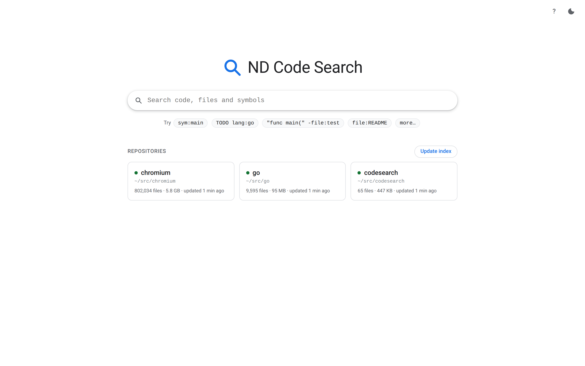
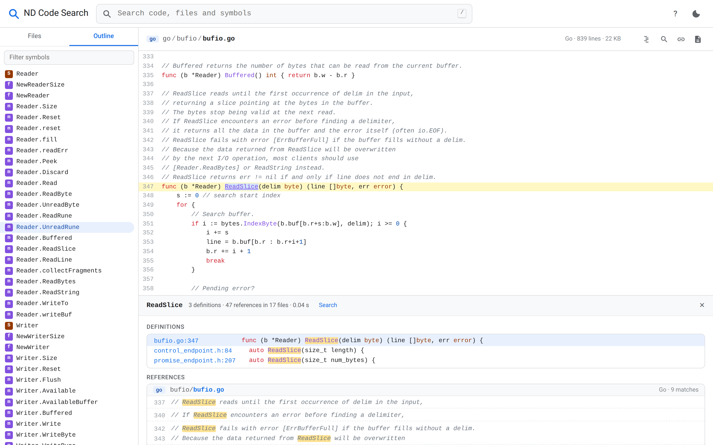

# ND Code Search

**Fast, self-hosted code search for the repositories on your own machine**, in the
spirit of Google's [Code Search](https://opensource.googleblog.com/2020/04/code-search-for-google-open-source.html)
and [cs.android.com](https://cs.android.com). Point it at a list of folders, and get
regex search, syntax highlighting, click-through definitions and references, git
blame and history, all in a clean web UI that handles trees as large as Chromium
or AOSP.


ND Code Search builds on Russ Cox's trigram-index [codesearch](https://github.com/google/codesearch)
tools and adds a configurable incremental indexer and a full web app.

## Features

**Search**
- Regular expression search over every indexed repository, narrowed by a
  trigram index so that queries over a million files take a fraction of a second.
- Google Code Search–style queries: `file:`, `lang:`, `repo:`, `sym:`, `case:`,
  `-term`, `OR`, `NOT`, and `( )` grouping; path globs like `file:src/**/*.kt`.
- File and folder name matches, plus suggestions as you type.
- Results ranked with definitions first, and a sidebar to narrow by repository,
  language and directory.
- Expand any result in place to see the lines around each match.
- Saved searches (shared across your devices) and per-browser history of
  searches and recently viewed files.

**Code browsing**
- Syntax highlighting for about 300 languages (via [Chroma](https://github.com/alecthomas/chroma)),
  including Android files such as `Android.bp`, AIDL, HIDL and `.rc`.
- Click any identifier to see its definitions and references; Ctrl/⌘-click jumps
  straight to the definition.
- File tree, file outline (classes, functions, methods), find in file, and links
  to lines or line ranges.
- Permalinks pinned to the current git commit.
- In-place preview of HTML files, sandboxed away from the app.

**Git**
- Blame: who last changed each line, and when.
- File history that follows renames, with diffs, and any version of a file one click away.
- Works with nested repositories such as AOSP's `repo` checkouts.

**Indexing**
- A YAML config file lists the folders to index and where the index lives.
- Incremental: after the first run, only files whose size or modification time
  changed are re-read, and only the affected index shards are rewritten.
- Honors `.gitignore` files (including nested ones) plus your own exclude patterns;
  binaries and build output are skipped by default.
- The web server keeps the index fresh in the background.

**Everywhere**
- Light and dark themes, keyboard shortcuts, and a layout that works on phones.

## Screenshots

| | |
|---|---|
|  |  |
| **Home:** your repositories at a glance | **Click-through navigation:** definitions, references and the file outline |
|  |  |
| **Git:** blame, history and commit diffs | **Dark mode:** a 13,000-line Chromium file opened from a search |

<p align="center"></p>

## Performance

Measured on an AMD Ryzen 9 7950X (16 cores, 32 threads) on Linux, with the
source files already in the OS page cache. Your numbers will vary with disk
speed, CPU and cache state.

| Task | Size | Time |
|---|---|---|
| Full index of a Chromium checkout | 802,000 files, 5.8 GB of text | ~21 s |
| Re-scan with nothing changed | 115,000 files | 0.2 s |
| Incremental update after editing 5 files | 115,000 files | 0.6 s |
| Typical searches | 800,000+ files | 50–400 ms |

The index takes roughly 10% of the size of the indexed source.

## Quick start

Requires [Go](https://go.dev/dl/) 1.23 or newer, and `git` for blame and history.

```sh
go install github.com/ndesai/codesearch/cmd/...@latest
```

or, from a clone:

```sh
git clone https://github.com/ndesai/codesearch
cd codesearch
go install ./cmd/...
```

Create a configuration file listing the folders to search:

```sh
mkdir -p ~/.config/codesearch
cp codesearch.example.yaml ~/.config/codesearch/config.yaml
$EDITOR ~/.config/codesearch/config.yaml
```

```yaml
index_dir: ~/.cache/codesearch     # where the index is stored
listen: localhost:2473
update_interval: 10m               # background re-indexing; 0 to disable

repos:
  - path: ~/src/myproject
  - name: aosp
    path: ~/aosp
    exclude: [/out, /prebuilts]    # "/name" = only at the repository root
```

Then start the web app and open <http://localhost:2473/>:

```sh
csweb
```

`csweb` builds the index in the background on first start and keeps it up to
date. You can also index from the command line (for example from cron):

```sh
csindex            # build or incrementally update the index
csindex -status    # what is indexed, and how big
csindex -full      # rebuild from scratch
```

See [`codesearch.example.yaml`](codesearch.example.yaml) for every option:
exclude patterns, file size limit, shard size, indexing parallelism, and more.

## Search syntax

| Query | Meaning |
|---|---|
| `foo bar` | Files containing both `foo` and `bar`. Each term is a regular expression. |
| `foo OR bar` | Files containing either. |
| `-foo`, `NOT foo` | Exclude files containing `foo`. |
| `(a OR b) -file:test` | Grouping. `file:` and `lang:` work inside groups too. |
| `"foo(bar"` | Literal text. Invalid regular expressions are also searched literally. |
| `file:\.cc$` | Path matches a regular expression (also `f:`, `-file:`). |
| `file:src/**/*.kt` | Path glob: `*` within a folder, `**` across folders, leading `/` anchors at the root. |
| `lang:java` | Language: `c`, `c++`, `java`, `kotlin`, `go`, `py`, `rust`, `ts`, `bp`, `aidl`, … |
| `repo:aosp` | Repository name (also `-repo:`). |
| `sym:Activity` | Definitions of a symbol. |
| `case:yes` | Case-sensitive. Search is case-insensitive by default; `case:auto` is case-sensitive only for terms with upper-case letters. |

## Keyboard shortcuts

| Key | Action |
|---|---|
| `/` | Focus the search box |
| `j` / `k`, `Enter` | Next / previous search result, open it |
| `f` | Find text in the current file |
| `n` / `N` | Next / previous match in the file |
| `b` | Toggle blame |
| `h` | File history |
| `o` | File outline |
| `y` | Copy a permalink pinned to the current commit |
| `t` | Toggle the sidebar |
| `Esc` | Close the bottom panel |
| `?` | Help |

## How it works

- **Trigram index.** Each file is indexed by the three-byte sequences (trigrams)
  it contains. A regular expression query is turned into a boolean query over
  trigrams that picks a small set of candidate files, which are then searched
  with a fast DFA regular expression engine. Russ Cox's article
  [Regular Expression Matching with a Trigram Index](https://swtch.com/~rsc/regexp/regexp4.html)
  explains the approach.
- **Sharded, incremental indexing.** Each repository is split into shards
  covering ranges of paths. A manifest records every file's size and
  modification time; an update walks the tree in parallel (metadata only),
  re-reads only changed files, and merges a small delta index into each
  affected shard.
- **Search-based cross references.** Clicking an identifier searches the index
  for the whole word and classifies each hit as a definition or a reference
  with per-language heuristics. This works for every language without building
  the code, at the cost of the occasional misclassified line. It is not
  compiler-accurate like Kythe-based cross references.
- **Git integration** runs `git blame`, `git log` and `git show` on demand,
  with timeouts.

See [ARCHITECTURE.md](ARCHITECTURE.md) for a tour of the code.

## Security

ND Code Search serves your source code and has no login. Keep `listen` on
`localhost` (the default), or bind it only to a private network such as your
Tailscale address. On localhost it rejects requests addressed to other host
names, which blocks DNS-rebinding attacks from web pages you visit. Raw files
are always served as plain text, and HTML previews run in a sandbox with no
access to the app.

## Command-line tools

| Command | Purpose |
|---|---|
| `csweb` | The web app (also keeps the index up to date) |
| `csindex` | Build and incrementally update the index from the config file |
| `cindex`, `csearch`, `cgrep` | The original single-index command-line tools from google/codesearch |

## Credits and license

Based on [google/codesearch](https://github.com/google/codesearch) by Russ Cox.
Syntax highlighting by [Chroma](https://github.com/alecthomas/chroma).
Distributed under the BSD-style license in [LICENSE](LICENSE).
